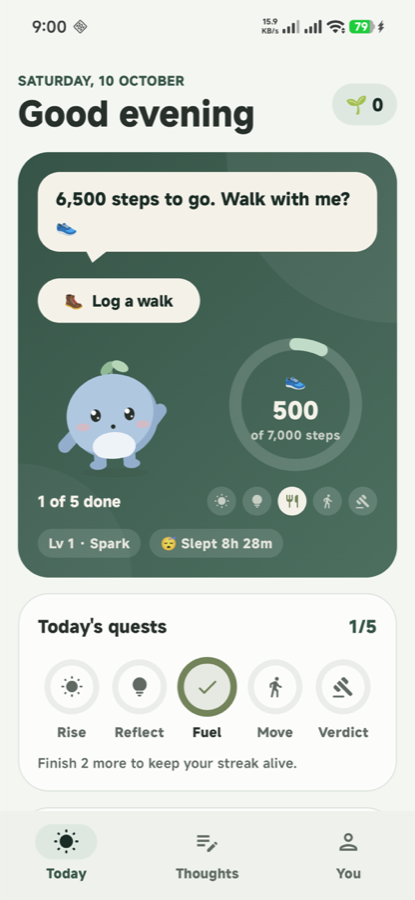
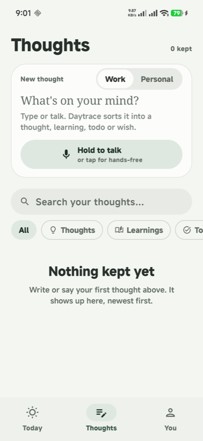
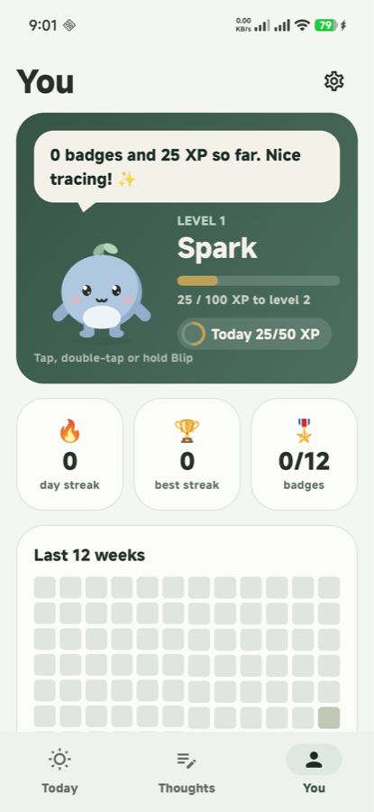

<p align="center">
  
</p>

<h1 align="center">Daytrace</h1>

<p align="center">
  A calm, fitness-first life tracer for Android. It quietly traces your day, so you can see it clearly.<br>
  Steps, sleep, meals, mood, screen time and the thoughts worth keeping, with almost nothing to type.
</p>

<p align="center">
  
</p>

<p align="center">
  
  &nbsp;
  
  &nbsp;
  
</p>

## Why

Most trackers ask for too much. Daytrace collects what the phone already knows, asks only for the
few things it can't (a mood, a meal, a one-line verdict on the day) and turns the rest into a small,
friendly game. It's built for short attention spans: one-tap nudges, no guilt, and a mascot called
**Blip** who's always happy to see you.

## Features

**Today**
- A forest-green hero with Blip, a live steps ring and five daily quests: *Rise*, *Reflect*, *Fuel*,
  *Move* and *Verdict*.
- One-tap logging for mood, meals, walks and an end-of-day verdict.
- XP, levels, streaks with a weekly shield, badges and weekly challenges, always including one
  movement goal.

**Thoughts**
- Type or hold to talk. Each capture is sorted automatically into a thought, learning, todo or wish.
- Search by words, or by meaning once cloud backup is on. Filter by kind or by work and personal.

**Automatic tracing**
- [Health Connect](https://developer.android.com/health-and-fitness/guides/health-connect) steps,
  walks, sleep and meals, from Google Fit, Samsung Health, MyFitnessPal and others.
- Screen time per app, from Android usage stats.
- Sleep estimated from phone use when no tracker records it.

**Sleep and mornings**
- Nudges at *your* times (wake, meals, walk, bedtime), with quiet hours and a daily cap. Each one is
  answerable straight from the notification.
- A **plant alarm**: it rings loudly in one-minute bursts and only stops when you photograph a
  plant. The photo is checked on the device with ML Kit and never saved.
- An opt-in **bedtime lock**: after bedtime only the essentials open. Everything else shows a
  gentle wind-down screen with ideas such as reading a book, breathing, or writing a thought down.

**Home-screen widget**
- Blip, quest chips, step progress and the next small thing to do.

## Design

One calm theme with **forest green** as its single primary colour, on soft green-tinted neutrals.
It's easy on the eyes in light and dark mode. Motion follows the
[12 principles of animation](https://en.wikipedia.org/wiki/Twelve_basic_principles_of_animation):
Blip crouches before a hop, squashes on landing, and its leaf sprout lags behind and settles.
See [docs/DESIGN_SYSTEM.md](docs/DESIGN_SYSTEM.md).

## Tech

| | |
|---|---|
| App | Kotlin, Jetpack Compose (Material 3), Room, WorkManager, Glance widget |
| Data | Health Connect, `UsageStatsManager`, ML Kit image labelling (on device) |
| Backend (optional) | Supabase: Postgres, Auth and Edge Functions (`supabase/`) |
| Tooling | An MCP server and an export script so Claude can search your thoughts (`tools/`) |

Everything is stored on the phone first. Cloud backup is optional, and the app works fully offline.

## Getting started

Requirements: Android Studio (or JDK 21 and the Android SDK) and a device on Android 8.0 (API 26) or newer.

```bash
./gradlew :app:assembleDebug :app:testDebugUnitTest
adb install -r app/build/outputs/apk/debug/app-debug.apk
```

For cloud backup, add your own Supabase project to the untracked `local.properties`:

```properties
SUPABASE_URL=https://<project>.supabase.co
SUPABASE_PUBLISHABLE_KEY=<publishable key>
```

Then apply `supabase/migrations/` in order and deploy the functions in `supabase/functions/`.
The full setup is in [docs/README.md](docs/README.md).

## Docs

- [Product plan](docs/DAYTRACE_PLAN.md): what Daytrace does and why, phase by phase.
- [Architecture](docs/ARCHITECTURE.md): code map, data model, sync and search.
- [Design system](docs/DESIGN_SYSTEM.md): tokens, colour roles, motion and Blip.
- [Roadmap](docs/ROADMAP.md).

## License

[MIT](LICENSE) © 2026 Sourav Ganguly
