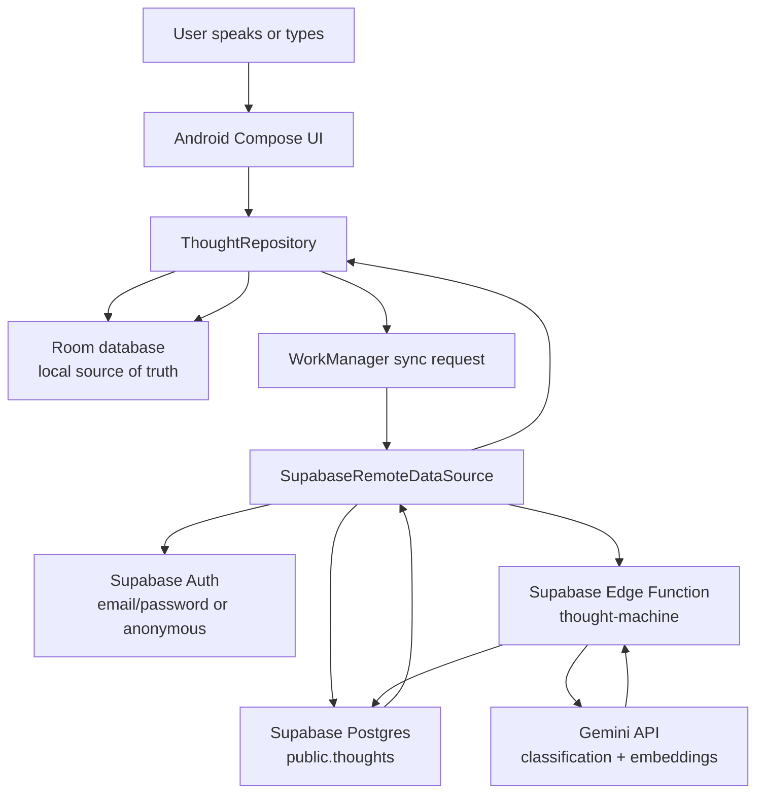

# Hold This Thought — architecture

Last updated: 2026-07-26

## High-level flow

## Android app

Package: `dev.holdthisthought`

Important files:

- `app/src/main/java/dev/holdthisthought/MainActivity.kt`
  - Single-activity Jetpack Compose UI.
  - Contains auth screen, drawer, capture screen, list/search screens, and speech CTA.
  - Uses `SpeechRecognizer` with offline preference when the device recognition service supports it.

- `app/src/main/java/dev/holdthisthought/ui/AppTheme.kt`
  - Material 3 theme.
  - Current visual decision: clean neutral work-style color scheme for both Work and Personal spaces.

- `app/src/main/java/dev/holdthisthought/ui/ThoughtViewModel.kt`
  - Holds UI state:
    - draft text.
    - selected work/personal space.
    - current destination.
    - search query.
    - capture/auth messages.
  - Bridges UI actions to repository/auth.

- `app/src/main/java/dev/holdthisthought/ThoughtApplication.kt`
  - Creates Room database, repository, Supabase remote data source.
  - Schedules WorkManager sync on startup and after captures.

## Local data model

File: `app/src/main/java/dev/holdthisthought/data/Thought.kt`

Local entity:

- `id: String`
- `body: String`
- `kind: ThoughtKind`
  - `NOTE`
  - `TODO`
  - `THOUGHT`
- `space: ThoughtSpace`
  - `PERSONAL`
  - `WORK`
- `createdAt: Long`
- `updatedAt: Long`
- `completedAt: Long?`
- `syncState: SyncState`
  - `PENDING`
  - `SYNCED`

The local database is Room, stored as `hold-this-thought.db`.

## Capture path

1. User types or speaks.
2. `ThoughtViewModel.save()` calls `ThoughtRepository.capture()`.
3. Repository trims empty input.
4. Repository creates a UUID and timestamps.
5. Repository runs local heuristic classification.
6. Repository writes to Room immediately with `syncState = PENDING`.
7. Repository schedules background sync.

This path is intentionally offline-first. Saving must not depend on Supabase, Gemini, or network connectivity.

## Local classification

The local classifier is intentionally simple and fast:

- Explicit todo-like phrases become `TODO`, for example:
  - `todo`
  - `to do`
  - `remind me`
  - `i need to`
- Action-verb starts become `TODO`, for example:
  - `clean`
  - `clear`
  - `call`
  - `send`
  - `write`
- Explicit note-like phrases become `NOTE`, for example:
  - `note`
  - `remember that`
- Everything else becomes `THOUGHT`.

The sync worker also repairs generic local `THOUGHT` rows if the local classifier can now identify them more specifically.

## Sync path

File: `app/src/main/java/dev/holdthisthought/sync/ThoughtSyncWorker.kt`

1. WorkManager runs only when network is connected.
2. Worker exits successfully if Supabase is not configured.
3. Worker repairs local classifications.
4. Worker loads pending thoughts from Room.
5. `SupabaseRemoteDataSource.sync()` checks for a valid Supabase session.
6. Pending thoughts are upserted into `public.thoughts`.
7. For each pending thought, Android invokes the `thought-machine` Edge Function with `action = "enrich"`.
8. The app reads remote `id, kind` values back from Supabase.
9. If sync completed, local rows are marked `SYNCED` and local kinds are updated.

Important behavior: if there is no Supabase session, sync returns `completed = false`, so local pending items are not incorrectly marked synced.

## Supabase architecture

Migration:

- `supabase/migrations/202607250001_create_thoughts.sql`

Database:

- Extension: `vector` in `extensions` schema.
- Table: `public.thoughts`.
- RLS enabled.
- Owner policy: authenticated users can only operate on rows where `auth.uid() = user_id`.
- Anonymous users sign in through Supabase Auth and then use the `authenticated` role, so they are still scoped by `user_id`.
- `anon` table grants are revoked.
- `authenticated` gets select/insert/update/delete on `public.thoughts`.

Indexes:

- `thoughts_user_id_idx` for ownership and foreign-key lookups.
- `thoughts_active_user_created_idx` for active list queries.
- `thoughts_embedding_idx` using HNSW vector cosine ops for semantic search.

RPC:

- `public.match_thoughts(query_embedding vector(768), match_count integer)`
- Returns owner-scoped, active, embedded thoughts ordered by cosine similarity.
- Uses `security invoker`, so RLS remains part of the access model.

## Edge Function

File:

- `supabase/functions/thought-machine/index.ts`

Secrets/environment:

- `GEMINI_API_KEY` in Supabase Edge Function custom secrets.
- `SUPABASE_URL` and `SUPABASE_ANON_KEY` are default Supabase function secrets.

Actions:

- `enrich`
  - Input: `thoughtId`.
  - Reads the thought through the caller’s Authorization header.
  - Classifies body as `NOTE`, `TODO`, or `THOUGHT` using Gemini.
  - Generates a 768-dimensional document embedding.
  - Updates the same row with AI kind and embedding.

- `search`
  - Input: `query`.
  - Generates a 768-dimensional query embedding.
  - Calls `match_thoughts`.
  - Returns semantic matches.

Security note: Gemini calls happen only inside the Edge Function. The Android APK should never contain `GEMINI_API_KEY`.

## Auth model

Current MVP auth options:

- `Continue privately`
  - Uses Supabase anonymous auth.
  - Best for quick private MVP testing.
  - Creates a Supabase Auth user under the hood, even though the user does not enter email/password.

- Email/password
  - Available but can hit Supabase rate limits during repeated testing.
  - More appropriate once multi-device continuity matters.

Important privacy framing:

- Anonymous auth is not “no user”; it is “no email/password, but still a user id”.
- RLS still applies.
- If the app is reinstalled and the anonymous session is lost, that anonymous identity may be lost unless later linked to a permanent account.

## AI provider decision

The architecture currently uses Gemini for cost reasons.

OpenAI SDK could still be used in the future, but consumer ChatGPT/OpenAI login/subscription should not be treated as API authentication for this app. Production app model calls should use provider API keys or a server-side provider integration, not a user’s ChatGPT session.

## Current gap: semantic search UI

The backend has semantic search support:

- Gemini query embeddings.
- `match_thoughts` RPC.
- Edge Function `search` action.

The Android app search screen currently uses local Room text matching. A future slice should add hybrid search:

1. Show local text results instantly.
2. If signed in/online, call Edge Function semantic search.
3. Merge/dedupe results.
4. Clearly avoid exposing sync/debug failures on the capture screen.

