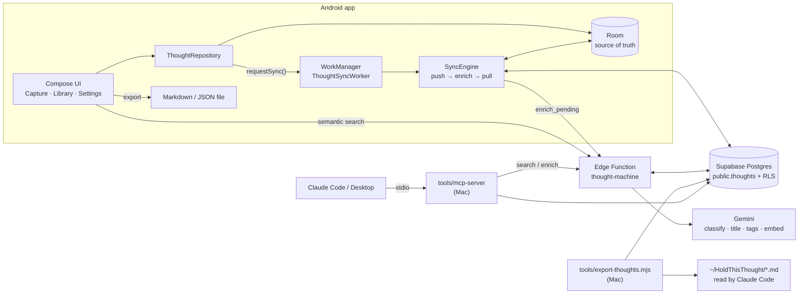

# Hold This Thought — architecture

Last updated: 2026-10-10 (v0.3.0, "Daytrace"). Product plan: `DAYTRACE_PLAN.md`.

A personal, single-user thought collector. Capture is instant and offline; the cloud is a
backup plus an AI enrichment layer; exports make the collection usable by Claude and other tools.

## Principles

1. **The phone is the source of truth.** Every write goes to Room first. Network and AI never
   block capture, and sync problems are only visible in Settings.
2. **The user's words are sacred.** AI adds `title`, `tags` and a refined `kind`, but never edits
   `body`. A kind the user picked (`kind_source = USER`) is never overridden.
3. **Sync is boring and idempotent.** UUID primary keys, upserts, soft deletes, a server-owned
   change cursor. Re-running a sync is always safe.
4. **No secrets in the APK.** Only the Supabase publishable key ships; Gemini is called from an
   Edge Function. Row Level Security limits every row to its owner.

## System overview

## Android code map (`app/src/main/java/dev/holdthisthought/`)

| Package | Responsibility |
| --- | --- |
| `ThoughtApplication.kt` | `AppContainer`: manual DI wiring; schedules sync on start. |
| `MainActivity.kt` | Edge-to-edge shell, bottom navigation (Capture / Library / Settings), shared snackbar. |
| `data/local/` | Room entity `Thought`, `ThoughtDao`, `ThoughtDatabase` + `MIGRATION_1_2`. Schemas exported to `app/schemas/`. |
| `data/remote/` | `SupabaseRemoteDataSource`: auth, push, pull, Edge Function calls. Knows nothing about Room. |
| `data/ThoughtRepository.kt` | The only API the UI uses. Every write marks the row `PENDING` and requests a sync. |
| `data/LocalClassifier.kt` | Instant offline kind guess (TIL → Learning, "remind me" → Todo, …). |
| `data/AppPreferences.kt` | Small prefs: default space, pull cursor, synced account id, last sync status. |
| `sync/SyncEngine.kt` | Two-way sync algorithm (below). Mutex-guarded. |
| `sync/ThoughtSyncWorker.kt` | WorkManager worker + `SyncScheduler` (debounced one-off + 6-hourly periodic). |
| `speech/SpeechCapture.kt` | Continuous dictation over `SpeechRecognizer`; auto-restarts through pauses. |
| `export/ThoughtExporter.kt` | Markdown (LLM-friendly) and JSON exports. |
| `ui/theme/` | Colours (light + dark), per-kind accent palette, serif display typography. |
| `ui/components/` | Pills, kind badges, `ThoughtCard`, date helpers. |
| `ui/capture/`, `ui/library/`, `ui/settings/` | One screen + one `AndroidViewModel` each. Settings is the "You" tab. |
| `data/local/TraceEntities.kt`, `TraceDao.kt` | Check-ins (`entries`), app usage (`usage_intervals`), `wakeups`. |
| `data/CheckInRepository.kt` | Mood, meal, walk and verdict logging (local; sync is phase 2). |
| `daytrace/` | Device-token client for the `daytrace` function: settings (excluded from backup), `IntervalBuilder` (pure), `UsageCollector`, uploader, workers (15-min collect, wake-up retry), boot receiver. |
| `game/GameEngine.kt` | Pure: quests, XP, levels, streak (with weekly shield), badges, weekly challenges, nudges. Derived from data, never stored. |
| `widget/` | Glance "Good morning" widget with Blip. |
| `ui/today/` | Today: Blip hero, quests, challenges, mood, meals, screen time; check-in sheets. |
| `ui/you/` | Profile (level, badges, 12-week calendar) and day-tracing device settings. |
| `ui/components/Blip.kt` | The mascot: matte 2D with arms and legs; moods, reactions (tap/double-tap/long-press), level evolutions. |
| `health/` | Health Connect (read-only): `HealthConnectSource` (availability, permissions, one day's steps/walks/sleep/meals), `HealthRepository` (re-reads the last 7 days into `health_days`), the required rationale screen. Feeds GameEngine (Move/Fuel auto-complete) and nudges; daily totals upload to `POST /daytrace/health`. |
| `notify/` | Nudges: pure `NudgeScheduler` (what's due), rotating `NudgeCopy`, `Notifier` (one-tap actions), `NudgeActionReceiver` (logs + reward), `NudgePrefs`. Checked by the 15-minute worker. |

## Data model

Room `thoughts` (local) mirrors `public.thoughts` (cloud):

| Field | Owner | Notes |
| --- | --- | --- |
| `id` | device | UUID, primary key everywhere |
| `body` | user | original words, never rewritten |
| `kind` | user / AI | `THOUGHT`, `LEARNING`, `TODO` |
| `kind_source` | user | `AUTO` (AI may refine) or `USER` (locked) |
| `space` | user | `WORK`, `PERSONAL` |
| `input` | device | `TEXT`, `VOICE` |
| `title`, `tags` | AI | written only by the Edge Function |
| `created_at`, `updated_at`, `completed_at`, `deleted_at` | user | `deleted_at` is a soft delete so deletions sync |
| `syncState` | device only | `PENDING` = has changes the cloud hasn't seen |
| `embedding`, `enriched_at`, `server_updated_at` | server only | `server_updated_at` is set by a trigger on every write |

## Sync algorithm (`SyncEngine.sync()`)

1. **Account check.** If a *different* account than last time is signed in, local rows are
   re-keyed with new UUIDs and re-uploaded to the new account; the pull cursor resets.
2. **Push.** Upsert all `PENDING` rows, user-owned columns only (so AI columns are never
   clobbered). Each row is marked `SYNCED` only if `updatedAt` is unchanged (no lost edits).
3. **Enrich (best effort).** Call `thought-machine` `enrich_pending`. The server processes up to
   20 un-enriched rows. Failure is logged and ignored; rows are retried on the next sync.
4. **Pull.** Fetch rows with `server_updated_at >= cursor`, 500 per page, and merge:
   - unknown locally → insert;
   - local row `PENDING` → keep the user's fields, adopt AI `title`/`tags` (and `kind` if both sides are `AUTO`);
   - otherwise → take the server row.

Triggers: on every capture/edit (2 s debounce), on app start, every 6 h, and "Sync now" in
Settings. WorkManager retries with exponential backoff.

## Supabase

- `supabase/migrations/202607250001_create_thoughts.sql`: table, RLS, pgvector, `match_thoughts`.
- `supabase/migrations/202610040001_two_way_sync_and_learnings.sql`: NOTE → LEARNING, AI/sync
  columns, `thoughts_touch` trigger, indexes, new `match_thoughts` (returns ids).
- `supabase/functions/thought-machine/index.ts`: actions `enrich_pending` and `search`. Runs with the
  caller's JWT so RLS applies.

## Auth

Personal use: one email/password account. The app works fully without signing in (local only).
An existing anonymous session can be upgraded in place ("Secure my account") so its user id
and cloud rows are kept. Signing out keeps local data.

## Search

- **Literal (offline, instant):** SQL `LIKE` over body, title and tags.
- **By meaning (online):** query embedding → `match_thoughts` (cosine, similarity ≥ 0.5). Shown
  as a separate "Related by meaning" section, de-duplicated against literal matches.

## Using your thoughts with Claude

1. **Live (best): MCP server.** `tools/mcp-server` exposes `search_thoughts`, `recent_thoughts`,
   `list_todos`, `add_thought` and `complete_todo` to Claude Code and Claude Desktop. It signs in
   once (`npm run login`), keeps a refreshing session in `~/.config/hold-this-thought/`, and calls
   the same REST API, RLS rules and `thought-machine` function as the app. Thoughts added from
   Claude reach the phone on its next sync pull. See `tools/mcp-server/README.md`.
2. **Snapshot: folder export.** `tools/export-thoughts.mjs` writes `~/HoldThisThought/YYYY-MM.md`,
   `learnings.md` and a `CLAUDE.md` guide. Then run `claude` in that folder.
3. **From the phone:** Settings → Export → Markdown, then share the file.
